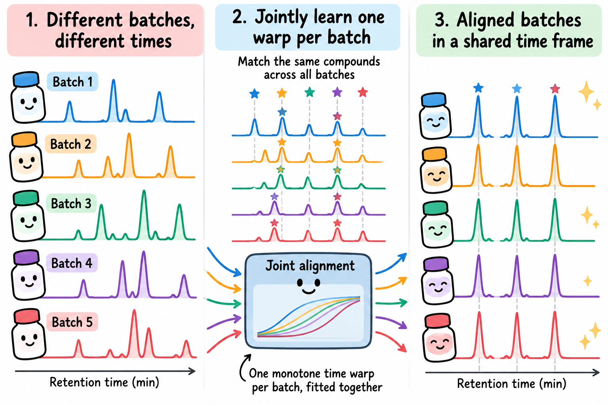

# joint-align

<p align="center">
  
</p>

<p align="center">
  <a href="https://github.com/woodRock/joint-align/actions/workflows/ci.yml"></a>
  
  <a href="https://github.com/astral-sh/ruff"></a>
  <a href="https://mypy-lang.org/"></a>
  
  <a href="tutorial/joint_from_scratch.ipynb"></a>
  <a href="docs/"></a>
  <a href="https://github.com/woodRock/warp-align"></a>
</p>

**Line up GC-MS chromatograms from many batches at once, with one smooth time warp per batch.**

## What problem does this solve?

In gas chromatography–mass spectrometry (GC-MS), each compound leaves the column at a
characteristic *retention time*. Samples run weeks or months apart, in different *batches*,
drift: the same compound shows up a little earlier or later in each batch. To compare samples
across batches, you first have to undo that drift, which is called *alignment*.

Most methods align two batches at a time. With five batches that means ten separate pairwise
alignments, which need not agree with each other: going A → B → C can land somewhere different
from going A → C directly. This repository aligns **all batches together**:

1. **Match compounds.** Find peaks in every chromatogram and match them by mass spectrum
   across every pair of samples from different batches. Each match is an *anchor*: "this time
   in batch A is the same compound as that time in batch B".
2. **Fit one warp per batch.** Map every batch into a shared time frame with a smooth,
   always-increasing warp. All warps are fitted together, so every anchor helps every batch.
3. **Get consistent, uncertainty-aware alignments.** Any batch can be mapped onto any other
   through the shared frame, so the pairwise maps are consistent by construction. A bootstrap
   gives error bands.

It follows up the pairwise Test-Time Calibrated WarpTransformer
([woodRock/warp-align](https://github.com/woodRock/warp-align), Python package `gcmsalign`), and
reuses that package's data loading, peak detection, baselines and metrics.

## Contents

- [Quick start](#quick-start)
- [Learn how it works](#learn-how-it-works)
- [Glossary](#glossary)
- [Results at a glance](#results-at-a-glance)
- [Method](#method-joint-monotone-batch-warps-jointalignmultibatch)
- [Results on fish oil](#results-on-fish-oil)
- [Limitations](#limitations)
- [Use it as a library](#use-it-as-a-library)
- [Development setup](#development-setup)
- [Repository layout](#repository-layout)
- [Open questions](#open-questions)

## Quick start

You need Python 3.11. The real fish oil data is private, so the quick start uses a public
synthetic stand-in with the same design and *known* true drifts.

```bash
git clone https://github.com/woodRock/joint-align.git
cd joint-align
pip install -e ".[dev,neural]"      # the package, plus the pinned gcmsalign from GitHub

python scripts/00_make_synthetic_data.py
python scripts/30_multibatch_align.py --data data/synthetic --results results/synthetic --figs figs/synthetic
python scripts/32_fair_benchmark.py   --data data/synthetic --results results/synthetic --neural-steps 300
```

The pipeline takes about 2.5 minutes in all. Then look at:

- `results/synthetic/multibatch_align.txt`: the report, covering TIC r per batch pair,
  cross-validation, cycle consistency and uncertainty.
- `figs/synthetic/multibatch_warps.png`: the fitted warp for each batch.
- `data/synthetic/truth.json`: the true drifts, so you can check the fit yourself.

`tests/test_pipeline.py` runs the same demo. It checks that the joint warps recover the true
drifts to within 0.15 min wherever compounds exist in both batches. Script 31 (the
WarpTransformer) needs gcmsalign's pretrained checkpoint, and script 32 skips that method when
its warps are absent.

## Learn how it works

- **[Tutorial notebook](tutorial/joint_from_scratch.ipynb).** Build the joint model from scratch
  on a toy world small enough to print every array. It has 18 short sections with plots,
  sliders and exercises, and it ends by checking that the toy code matches `jointalign.multibatch`
  to about 1e-10 bins. Install the package with `pip install -e ".[dev,tutorial]"`, then run
  `jupyter lab tutorial/joint_from_scratch.ipynb`. It is saved with its outputs, so GitHub shows
  the figures without running it.
- **[Companion slides](tutorial/The%20Joint%20Model,%20Step%20by%20Step.pdf)** ([pptx](tutorial/The%20Joint%20Model,%20Step%20by%20Step.pptx)).
  20 slides that walk through the same steps with the same small numbers, with refreshers on
  matrices, least squares and singular systems.
- **[Code map](tutorial/CODE_MAP.md).** Each paper concept mapped to the file, function and
  variable that implement it.
- **[Project site](#project-site).** An interactive walk-through of the method and the real
  results, in `docs/`.

## Glossary

| Term | Meaning here |
|---|---|
| **Retention time (RT)** | When a compound leaves the GC column. Time is binned into 200 bins of 0.225 min. |
| **Batch** | A set of samples run together. Drift is mostly shared within a batch and differs between batches. |
| **TIC** | Total ion chromatogram: the summed intensity over all m/z at each time bin. |
| **Anchor** | A pair of peaks in two samples from different batches, matched by mass spectrum as the same compound. |
| **Warp** | A monotone (always-increasing) map from one batch's time axis to another's, or to the shared frame. |
| **Joint model** | One warp per batch into a shared frame, fitted to all anchors at once. This repository's method. |
| **λ (lambda)** | Smoothness strength. Chosen by cross-validation on held-out anchors, never on TIC r. |
| **TIC r** | Pearson correlation of two normalised TICs after alignment. Higher is better; it is a proxy, not ground truth. |
| **Drifted / near-aligned pair** | A batch pair with unaligned TIC r below / above 0.5. |

## Results at a glance

On five fish oil batches (90 chromatograms, 25,011 anchors):

- **Joint warps align drifted batches best on average.** Mean TIC r on the drifted pairs is 0.598,
  against 0.572 for the same fitter run pairwise and 0.531 for pooled-anchor PCHIP. Unaligned,
  it is 0.066.
- **They do no harm where batches already agree.** On near-aligned pairs the joint warps score
  0.779, against 0.755 unaligned.
- **They are consistent by construction.** Composed pairwise warps disagree with the direct
  warp by 0.116 min on average over batch triplets, and by up to 0.277 min. Joint warps disagree
  by 0.000 min.
- **In the fair benchmark the joint model leads on drifted pairs under one protocol, not both.**
  Every method is scored under the same protocols, and the WarpTransformer is the weakest
  warping method under both.
- **Not yet solved.** Dense PCHIP wins on two pairs, and the 90 % intervals cover only 81 % of
  held-out anchors (see [Limitations](#limitations)).

All numbers below come from `results/` produced at gcmsalign `1ffaa24` (clean source tree).
TIC r is the Pearson correlation of normalised total ion chromatograms on the common acquisition
window (bins ≥ 22, i.e. from 5 min, when every run has started acquiring).

## Method: joint monotone batch warps (`jointalign.multibatch`)

Each batch k gets one warp f_k(t) = t + d_k(t) into a shared latent frame. d_k is piecewise
linear on 41 knots. All warps are fitted together in one bounded least-squares problem:

- **Anchors.** Peaks on the raw TIC are matched by mass spectrum between *every* cross-batch
  sample pair, with parabolic sub-bin refinement. This gives 25,011 anchors on the fish data. Each anchor
  constrains f_a(t_a) = f_b(t_b). Anchors are robustly reweighted, first with Huber weights and then
  with Tukey weights. 3.9 % end with weight 0.
- **Smoothness.** A penalty λ on the second differences of d_k. λ is chosen by **RT-blocked**
  cross-validation of held-out anchor error: whole retention-time windows are held out, so the
  score measures interpolation between compounds. TIC r is never used for selection. The
  selected value is λ = 10.
- **Monotonicity.** The slope of every f_k is bounded to 0.5–2.
- **Gauge.** The reference batch is the one with the most anchors (sep2015), and its drift is fixed at 0.
  An identity-on-average gauge is also implemented.

The warp from batch k to batch l is f_l⁻¹ ∘ f_k, so it is transitive by construction. A batch
pair with few or poor direct anchors borrows strength from the paths through the other batches.
Uncertainty comes from a bootstrap over samples within each batch (200 refits). The 90 %
predictive intervals combine the bootstrap band with each pair's robust anchor scatter.

`jointalign.neural_joint` adds an optional refinement. Per-sample monotone warps start at the
joint model and are trained on the anchors plus a groupwise m/z-resolved similarity term.

## Results on fish oil

### The joint model (`scripts/30_multibatch_align.py` → `results/multibatch_align.txt`)

Mean TIC r between batches, with A warped into B's frame, over all A_i × B_j. "Drifted" means
unaligned TIC r < 0.5, which gives six drifted pairs and four near-aligned pairs.

| Method | Drifted | Near-aligned |
|---|---|---|
| Unaligned | 0.066 | 0.755 |
| Pooled-anchor PCHIP (gcmsalign, A[0..2] vs B[0]) | 0.531 | 0.684 |
| Dense PCHIP (all anchors of the pair) | 0.558 | 0.575 |
| Pairwise smooth (same fitter, one pair's anchors) | 0.572 | 0.765 |
| **Joint** | **0.598** | **0.779** |
| Joint, cross-fitted (A_i's warp never saw A_i) | 0.596 | 0.778 |

- **Joint beats pooled-anchor PCHIP on every pair with n_A ≥ 6.** The median per-sample gain is
  +0.02 to +0.14 r (Holm p ≤ 2e-3). It also beats pairwise smooth on all six of those pairs.
  That gain is small (+0.006 to +0.028), but it holds in the cross-fitted comparison too.
- **The gain comes from borrowing across batches.** It is largest where the direct anchors are
  weakest. On aug2015 × jul2016 (two A samples), pairwise smooth gets 0.536 and joint gets 0.598.
- **Joint does no harm on near-aligned pairs.** Dense PCHIP and pooled-anchor PCHIP both lower
  TIC r there. Dense PCHIP falls to 0.399 on aug2015 × sep2015, against 0.731 unaligned.
- **Dense PCHIP wins the two sep2015 drifted pairs.** It scores 0.676 against 0.615 on
  sep2015 × jul2016, and 0.647 against 0.599 on sep2015 × apr2016. It also has the lowest
  held-out anchor error (median 0.035 min, against 0.060 min for joint). So the joint model's
  smoothing costs local accuracy where anchors are dense, and it gains where they are sparse
  or noisy.
- **Missing correspondences.** Refit without *any* anchors of the evaluated pair, and TIC r
  changes by at most 0.007 on nine of ten pairs. The exception is sep2015 × jan2016, which
  drops from 0.813 to 0.755. Fitting only against the reference batch (star design) stays within
  0.016 of the full joint fit.
- **Cycle consistency.** Pairwise warps disagree with each other by 0.116 min on average over
  the 60 ordered batch triplets, and by up to 0.277 min (jul2016 → aug2015 → jan2016). Joint
  warps disagree by 0.000 min.
- **λ is not critical.** For λ from 1 to 10,000, the drifted-pair TIC r stays between 0.595 and
  0.600. Only λ = 0.1 trades the pair types off: drifted pairs reach 0.622, and near-aligned
  pairs fall to 0.766.

### Fair benchmark (`scripts/31_wt_warps.py`, `scripts/32_fair_benchmark.py` → `results/fair_benchmark.txt`)

Published pairwise numbers mix protocols. Here every method is reduced to the map it estimates
(RT in B → RT in A) and scored the same way. *B-frame* warps A into B's raw frame. *Midpoint*
resamples both batches into the frame halfway between them. The WarpTransformer is gcmsalign's
v2 model with its own anchor calibration (`gcmsalign.steps.calibrate_pair`, seed 0). Mean TIC r
per group:

| Group | Protocol | Unaligned | Pooled PCHIP | PCHIP + COW | COW-TIC | WarpTransformer | Joint | Neural joint |
|---|---|---|---|---|---|---|---|---|
| Drifted (4 pairs) | B-frame | 0.087 | 0.530 | 0.583 | 0.539 | 0.506 | **0.601** | 0.585 |
| Drifted (4 pairs) | Midpoint | 0.087 | 0.599 | 0.661 | 0.575 | 0.583 | 0.654 | **0.673** |
| Near-aligned (2) | B-frame | 0.856 | 0.756 | 0.814 | **0.862** | 0.751 | 0.858 | 0.848 |
| aug2015 (4 pairs) | B-frame | 0.339 | 0.572 | 0.622 | **0.649** | 0.561 | 0.647 | 0.640 |

- **B-frame protocol:** joint has the best drifted-pair mean, and is the best method on 3 of
  the 4 drifted pairs.
- **Midpoint protocol:** neural joint has the best drifted-pair mean, ahead of PCHIP + COW refine
  and joint. Which method "wins" depends on the protocol, so report both.
- **The WarpTransformer is the weakest warping method in both protocols.** Joint beats it on all six tested
  pairs, by +0.06 to +0.12 in the B-frame protocol (Holm p ≤ 2e-3). Under its own native protocol
  it gets 0.54–0.64 on the drifted pairs.
- **COW-TIC fits a separate warp for every sample pair to maximise TIC r**, so it is strongest
  where little warping is needed (near-aligned and aug2015 pairs). It is weak on the drifted pairs.

## Limitations

- **Intervals under-cover.** The 90 % predictive intervals cover 81 % of held-out anchors, and
  the warp-only bands cover 15 %. A bootstrap of a regularised fit misses its bias, so the
  intervals need calibration (for example conformal scaling) before anyone relies on them.
- **Bands barely track evidence.** Median band widths are 0.044–0.054 min per pair. They widen
  only weakly where direct anchors are sparse (pooled Spearman ρ = −0.40, over bins where the warp
  is not clamped at a run end).
- **The gauge choice is not settled.** At the selected λ, the identity-on-average gauge has lower
  RT-blocked held-out error than the reference gauge (0.096 vs 0.111 min), but slightly lower
  TIC r. The selection rule fixes the reference gauge and only tunes λ.
- **Rejected anchors cluster in a few windows.** In 5-min windows, the robust fit rejects 11.1 %
  of anchors at 5–10 min, 7.6 % at 25–30 min and 6.9 % at 40–45 min, against 0.2–5.3 % in the
  other windows (Fig. S3, `figs/paper/`). Late in the run, bleed-like peaks with similar spectra
  plausibly produce the conflicting matches. The 25–30 min cluster is not explained yet. Beyond a
  batch's last compound, the warp is an extrapolation.
- **TIC r is a proxy.** It rewards overlapping peaks, not correct compound identities. That is
  why held-out anchor error is reported alongside it.
- **Thin testbed.** Five batches from one study, with batch confounded with species and tissue,
  and aug2015 has only two samples.

## Use it as a library

The joint model is the installable package `jointalign` (distribution name `joint-align`).
Pin it to a tag or commit so your results stay reproducible:

```bash
pip install "joint-align @ git+https://github.com/woodRock/joint-align@<tag-or-commit>"
pip install "joint-align[neural] @ git+https://github.com/woodRock/joint-align@<tag-or-commit>"  # + neural refinement
```

```python
import jointalign as ja

anchors = ja.harvest_anchors(chromas)            # chromas[k][i]: (T, M) array, sample i of batch k
model = ja.fit_joint(anchors, len(chromas), lam=10.0)
t_in_l = model.map(k, l, t)                      # retention times of batch k, mapped into batch l
```

Record which version produced your numbers with `jointalign.provenance.jointalign_revision()`.

## Development setup

Everything shared with the pairwise project comes from `gcmsalign`, not from a copy: the data
loader and data paths, peak detection and fingerprints, the pooled-anchor extraction, the
PCHIP/COW baselines, warping, the WarpTransformer and its calibration, and the metrics.
`pyproject.toml` pins gcmsalign to a pushed commit, and `pip install -e ".[dev,neural]"` installs
it. To work on both repositories, use an editable gcmsalign checkout instead, so a fix there applies
here immediately. Install this package with `--no-deps` (or `make install`), otherwise pip
replaces the editable gcmsalign with the pinned commit:

```bash
pip install -e path/to/warp-align         # editable checkout of github.com/woodRock/warp-align
pip install --no-deps -e .                # this package, editable (= make install)
make check                                # ruff, mypy, full tests + coverage
make test-fast                            # skips the end-to-end runs
```

Running on the fish oil data (needs access to the private data):

```bash
python scripts/30_multibatch_align.py     # joint model, ~4 min
python scripts/31_wt_warps.py             # WarpTransformer warps, ~50 min on CPU
python scripts/32_fair_benchmark.py       # every method, same protocols, ~5 min
python scripts/40_export_site_data.py     # refresh the project site's data
python scripts/50_paper_figures.py        # paper figures + captions, ~30 s
```

Scripts 30–32 reuse caches in `results/` (anchors, COW maps, neural warps, WarpTransformer warps).
Delete those caches when the data or gcmsalign changes. `tests/test_real_data.py` checks that
the results still match the data and the README.

Git holds the text reports (`results/*.txt`) and figure captions, not caches or binaries:
regenerate the `.npz` caches and the figure PDFs/PNGs with the scripts above.

Every result file records the gcmsalign version and commit, and whether its `src/` was dirty
(`jointalign.provenance.gcmsalign_revision`). Commit gcmsalign before a run whose results you
intend to keep. Projects that build on this package can record its revision the same way with
`jointalign.provenance.jointalign_revision()`.

CI (`.github/workflows/ci.yml`) runs ruff, mypy and the full test suite on every push and pull
request, against the gcmsalign commit pinned in `pyproject.toml`. Coverage must stay ≥ 90 %. A
package job installs the package non-editable into a clean environment and imports it from
outside the checkout, which catches files missing from the package.
The fish oil data is private, so the real-data tests run only locally. A non-blocking canary job
tests against gcmsalign's latest `main`, so a breaking upstream change shows up before the pin
is bumped.

## Project site

`docs/` is an interactive website explaining the project. Every chart is drawn from the real
results (`docs/data/site.json` and `site.js`, written by `scripts/40_export_site_data.py`). Open
`docs/index.html` directly or run `make site`. To publish it with GitHub Pages, go to Settings →
Pages → Deploy from branch, and choose `main` and `/docs`.

## Repository layout

- `src/jointalign/`: the installable package (`import jointalign`; distribution `joint-align`)
  - `multibatch.py`: joint K-batch alignment (anchor harvesting on every sample pair, joint fit,
    pairwise baselines); its public API is re-exported from `jointalign`
  - `neural_joint.py`: neural refinement of the joint model (needs torch)
  - `synthetic.py`: public synthetic data with known drifts (written by
    `scripts/00_make_synthetic_data.py`)
  - `provenance.py`: the gcmsalign and jointalign revision lines written into results
- `scripts/30_multibatch_align.py`: the full evaluation of the joint model
- `scripts/31_wt_warps.py`: WarpTransformer warps for every pair via `gcmsalign.steps.calibrate_pair`
- `scripts/32_fair_benchmark.py`: every method under the same scoring protocols
- `scripts/40_export_site_data.py`: exports the data behind the project site
- `scripts/50_paper_figures.py`: paper figures (`figs/paper/*.pdf`) and `figs/paper/captions.md`, whose
  numbers are computed from the results
- `scripts/analysis.py`: analyses shared by the site and the figures, so the two cannot disagree
  (paper-specific: it reads `results/`, so it is not part of the package)
- `tests/`: unit, synthetic end-to-end and real-data integrity tests
- `docs/`: the project site

## Data

The fish oil data and the WarpTransformer checkpoint are not tracked here. The scripts read
them from the gcmsalign checkout through `gcmsalign.config.Paths()`.

## Open questions

- **Calibrated uncertainty.** Conformal scaling of the predictive intervals, or a probabilistic
  warp head.
- **Gauge.** Select the gauge together with λ by RT-blocked error, or report both gauges.
- **Local accuracy vs borrowing.** Let the smoothness vary with direct anchor density, so the
  model can follow dense anchors as closely as dense PCHIP does.
- **Testbed.** A dataset with more batches and repeated QC samples, so batch is not confounded
  with biology.
